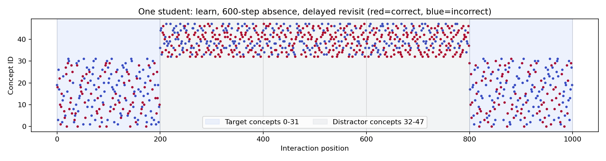
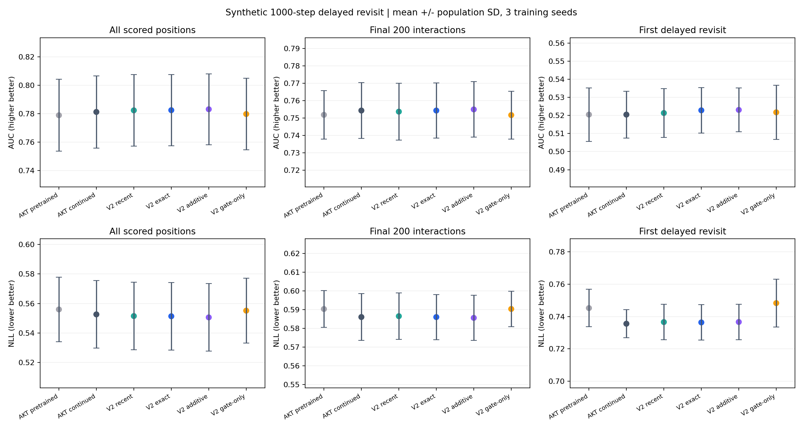

# 1000 步合成学习序列：AKT 与 LongMemTopKAKT V2 消融

## 数据与协议

- 每学生 1000 次交互，48 个知识点；48/12/24 名训练/验证/测试学生，共 84000 条交互。
- 前 200 步练习知识点 0–31，中间 600 步练习 32–47，最后 200 步回访 0–31。首次回访间隔超过 600 步，recent=200 无法保存对应历史。
- 每学生每知识点有独立初始掌握状态，未掌握状态每次练习以 0.015 概率转为掌握；回答包含能力、知识点难度和 Bernoulli 噪声。模型只能读取知识点与历史回答，不接收学生 ID、隐状态或阶段标签。
- block_len=200；每块首题均不计分，其他有效位置一致。测试整体 23880 个位置，回访块 4776 个，首次回访 744 个。
- 数据种子固定 20261025；模型种子 42,43,44。报告均值 ± 总体标准差，反映训练随机性，不代表数据重采样置信区间。
- AKT：qid、n_pid=0（无题目 ID 难度分支），d_model=32、n_blocks=2、4 heads、d_ff=64、dropout=0.1。remote_capacity=1000、Top-k=32、exact 检索。
- B0 全参数预训练 6 epochs；所有继续训练消融均为 4 epochs，共用该种子的 B0 checkpoint。按验证 NLL 选 checkpoint，不根据测试集选配置。
- B1 与 F 系列都只训练最后 Retriever 和预测头；G_exact 只训练 gate，因此它是冻结范围消融。学习率：预训练 1e-3、共享参数微调 1e-4、gate 1e-3。



## 结果

| 配置 | 整体 AUC | 整体 NLL | 整体 ACC | 回访块 AUC | 首次回访 AUC | 首次回访 NLL |
|---|---:|---:|---:|---:|---:|---:|
| B0_akt | 0.7788 ± 0.0253 | 0.5559 ± 0.0220 | 0.7374 ± 0.0175 | 0.7518 ± 0.0139 | 0.5205 ± 0.0148 | 0.7452 ± 0.0116 |
| B1_akt_continue | 0.7811 ± 0.0254 | 0.5526 ± 0.0229 | 0.7393 ± 0.0178 | 0.7543 ± 0.0162 | 0.5205 ± 0.0129 | 0.7355 ± 0.0087 |
| F_recent | 0.7822 ± 0.0251 | 0.5515 ± 0.0229 | 0.7401 ± 0.0178 | 0.7536 ± 0.0164 | 0.5213 ± 0.0134 | 0.7366 ± 0.0109 |
| F_exact | 0.7823 ± 0.0250 | 0.5513 ± 0.0229 | 0.7403 ± 0.0177 | 0.7543 ± 0.0159 | 0.5228 ± 0.0126 | 0.7363 ± 0.0109 |
| F_additive | 0.7830 ± 0.0249 | 0.5506 ± 0.0229 | 0.7408 ± 0.0180 | 0.7549 ± 0.0159 | 0.5231 ± 0.0121 | 0.7366 ± 0.0110 |
| G_exact | 0.7796 ± 0.0251 | 0.5551 ± 0.0219 | 0.7379 ± 0.0174 | 0.7517 ± 0.0138 | 0.5217 ± 0.0149 | 0.7483 ± 0.0148 |

本次结果：F_exact 相比匹配预算的 B1，整体 AUC 均值增加 0.001240，NLL 变化 -0.001274；但相比仅 recent，AUC 只增加 0.000105，NLL 变化 -0.000140。远期缓存的额外收益很小。

首次回访 AUC 仍约为 0.52，且 F_exact 的首次回访 NLL 均值未优于 B1。本轮没有显示出充分利用远期信息的效果。历史均值对照表明数据中确实有可预测的长期信号，而当前神经模型连块内统计对照也尚未超过；应把这视为当前训练/表示/记忆配置的小规模诊断，不据此否定长期历史的价值。

没有进行显著性检验；三种子标准差仅描述训练随机性。上述测试结果没有用于重新选择学习率、候选数或训练轮数。



## 配对差异与记忆依赖

下表为 F_exact − B1，同种子比较；AUC 正值/NLL 负值代表更好。

| seed | 整体 ΔAUC | 整体 ΔNLL | 首次回访 ΔAUC | 首次回访 ΔNLL | 训练后关闭 gate：整体 ΔNLL |
|---|---:|---:|---:|---:|---:|
| 42 | +0.00172 | -0.00218 | +0.00250 | +0.00395 | +0.00218 |
| 43 | +0.00167 | -0.00127 | +0.00374 | -0.00060 | +0.00139 |
| 44 | +0.00033 | -0.00037 | +0.00086 | -0.00094 | +0.00034 |

## 数据中长期信息的独立检查

固定 Laplace 平滑的同知识点历史均值 `(过去正确次数+1)/(过去练习次数+2)`，严格先预测再更新当前回答；不读取隐状态、不调参。

| 可用历史 | 整体 AUC | 首次回访 AUC | 首次回访 NLL |
|---|---:|---:|---:|
| block_only | 0.8203 | 0.5000 | 0.6931 |
| all_history | 0.8331 | 0.8449 | 0.4794 |

这证明本合成任务存在可用的远期信息，但不保证神经模型的当前检索与融合方式能利用好它。

## AKT 完整 1000 步上下文诊断

保持 B0 权重不变，仅把推理上下文从 200 扩为 1000，并保持完全相同的计分位置。这不是在 1000 步上下文上重新训练的模型。

| 推理上下文 | 整体 AUC | 整体 NLL | 首次回访 AUC | 首次回访 NLL |
|---|---:|---:|---:|---:|
| 1000 | 0.7851 ± 0.0246 | 0.5502 ± 0.0212 | 0.5421 ± 0.0125 | 0.7485 ± 0.0249 |
| 200（B0） | 0.7788 ± 0.0253 | 0.5559 ± 0.0220 | 0.5205 ± 0.0148 | 0.7452 ± 0.0116 |

## 预算与资源

| 配置 | 每种子 optimizer steps | 每种子计分训练标签 | 平均训练秒数 | 平均测试秒数 | 最大 bank 字节 |
|---|---:|---:|---:|---:|---:|
| B0_akt | 1440 | 286560 | 380.6 | 12.1 | 0 |
| B1_akt_continue | 960 | 191040 | 132.4 | 14.6 | 0 |
| F_recent | 960 | 191040 | 295.4 | 17.1 | 54400 |
| F_exact | 960 | 191040 | 242.1 | 22.1 | 272000 |
| F_additive | 960 | 191040 | 234.5 | 20.0 | 272000 |
| G_exact | 960 | 191040 | 163.1 | 14.4 | 272000 |

继续训练预算不含共同 B0 预训练；B0 本身不是匹配继续训练预算的对照。测试和训练均为 CPU；三个独立种子并发，每个进程一个 PyTorch 线程。运行秒数受并发和共享 CPU 影响，不作为严格吞吐基准。RSS 是各进程累计峰值，详细值保存在 comparison.json。

## 验证与边界

- 每种子的 B0/Z0 对齐相同 uid/position/target，并断言最大预测误差 ≤1e-6。各消融计分位置、optimizer steps、有效交互与计分训练标签一致。
- 数据设计和可重复性测试：`tests/test_synthetic_longmem_benchmark.py`，2 项通过；另以 200 步小数据、2 种子跑通 12 个端到端训练/评估流程（仅作为流水线测试，不计入本表）。
- 人造任务有意保留长期证据，结果仅反映该任务。不能据此推导真实数据集收益；样本量较小，只有一个数据种子，尚未做超参搜索。预训练只有 6 轮，验证损失仍在下降，不能视为充分收敛的最优模型对比。
- memory additive 仅改变 memory 分支；current 仍为原 AKT。gate=0 是同一训练后 checkpoint 的依赖性干预，不是独立训练 baseline。

## 复运行与产物

```bash
PYTHONPATH=. OMP_NUM_THREADS=1 /home/remote/u8016457/miniconda3/envs/pykt/bin/python \
  examples/experiment_long_mem_topk_akt_synthetic.py --output /tmp/synthetic1000-new-run
```

完整产物：`/home/remote/u8016457/my_code/pykt-long-mem-akt/examples/exp_synthetic_longmem_v2_1000`，包括 `data/*.csv`、数据 SHA256、resolved configs、每种子的 best.pt、逐 epoch 日志、逐位置预测、gate 干预、`summary.csv` 和 `comparison.json`。输出目录须尚不存在。

中途停止的串行耗时试跑位于相邻的 `_pilot` 目录；其结果不进入任何汇总。
